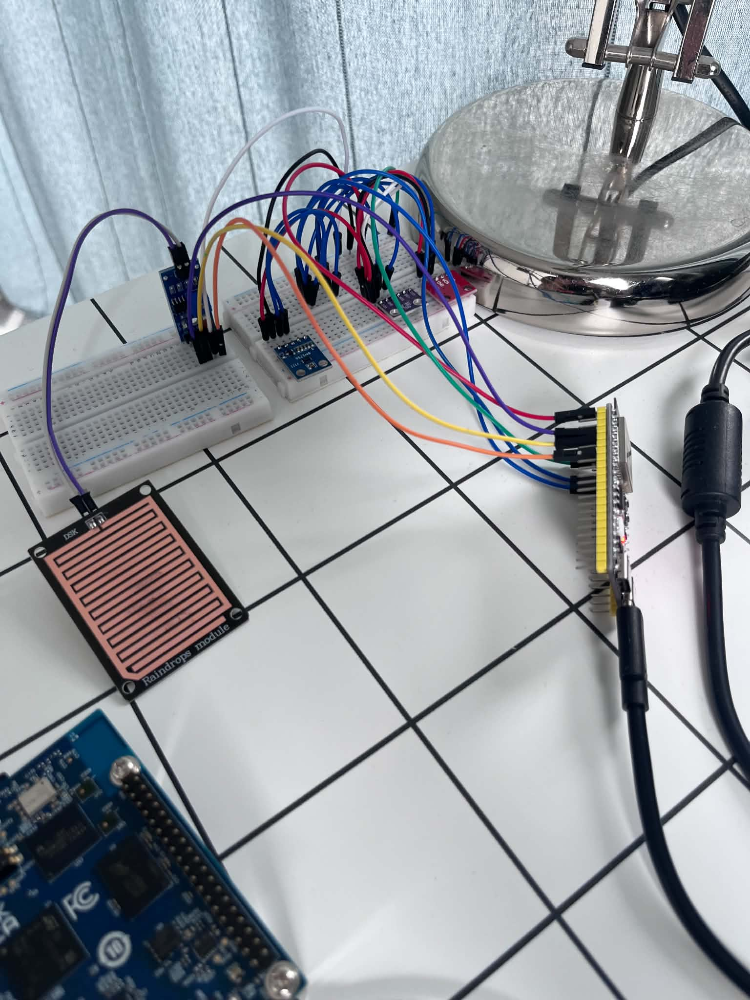
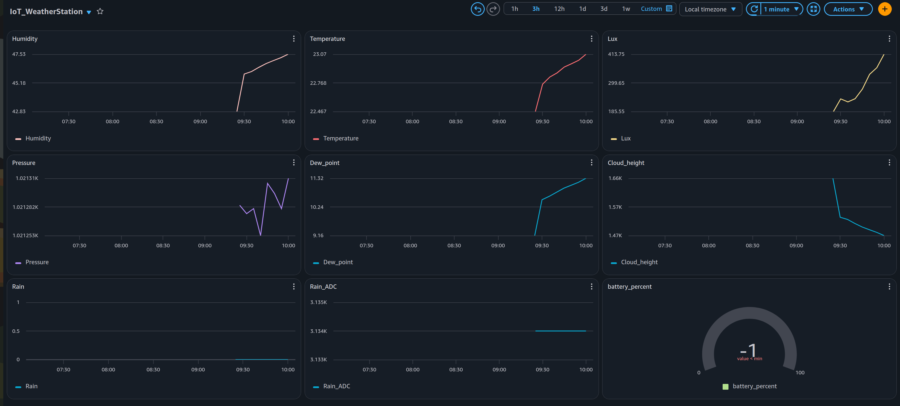

# IoT Weather Station

Celem tego projektu było stworzenie stacji pogodowej zintegrowanej z AWS Cloud i opartej na systemie Zephyr. Urządzenie
budzi się raz na ustaloną ilość czasu, którą można zmieniać zdalnie za pomocą AWS IoT Core poprzez opublikowanie jej na określonym
topicu. Wartościami mierzonymi są: temperatura, wilgotność, ciśnienie, naświetlenie oraz opad deszczu. Pomiar realizowany jest za pomocą
4 czujników: HTU21D, BMP280, BH1750 oraz standardowego czujnika deszczu (z miedzianą płytką). Na podstawie pomiarów wyliczany jest punkt rosy i wysokość chmur. System zwraca także informację o aktualnym poziomie baterii w %
za pomocą czujnika MAX17048. Wszystkie dane są wysyłane poprzez MQTT i możliwe do podglądu na dashboardzie w platformie AWS (zdjęcie tablicy dalej w dokumentacji).

The goal of this project was to develop an IoT weather station integrated with AWS Cloud. The system is based on Zephyr. The device wakes up after a specific amount of time,
which can be set remotely on AWS IoT Core by publishing the time value to a specific topic. Measured values are: temperature, humidity, pressure, light exposure and rainfall.
The measurements are based on: HTU21D, BMP280, BH1750 sensors and a standard rain sensor with a copper board. Based on the measurements, the system calculates the dew point and cloud height. The system also gives information about the % of battery left. All the data are sent
via MQTT and are available for inspection on the AWS dashboard (photo in the further documentation).

### Prototype



### AWS dashboard



## Hardware solution

* ESP32-S3 board
* HTU21D sensor
* BMP280 sensor
* BH1750 sensor
* Arduino rain sensor
* MAX17048 battery sensor

## Firmware / Cloud solution

* Zephyr RTOS
* Deep sleep
* WiFi/MQTT
* AWS IoT Core

## Build / flash

For the build / flash i used Tasks:

```json
{
  "version": "2.0.0",
  "tasks": [
    {
  "label": "Zephyr: build",
  "type": "shell",
  "command": "source ~/zephyrproject/.venv/bin/activate && west build -p always -b esp32s3_devkitc/esp32s3/procpu",
  "group": { "kind": "build", "isDefault": true },
  "problemMatcher": ["$gcc"]
},
{
  "label": "Zephyr: flash",
  "type": "shell",
  "command": "source ~/zephyrproject/.venv/bin/activate && west flash -r esp32 --esp-device /dev/ttyACM0",
  "problemMatcher": []
}
  ]
}
```

## Data format

The data is sent to AWS in JSON format.

Measurements (`AWS_PUBLISH_TOPIC_1`):

```json
{"Lux":123.45, "Pressure":1013.25, "Temperature":21.50, "Humidity":55.20,
 "Dew_point":12.10, "Cloud_height":1175.00, "Rain":0, "Rain_ADC":2450}
```

* `Rain` - digital output of the rain sensor (0/1)
* `Rain_ADC` - analog output of the rain sensor in mV
* `Dew_point` and `Cloud_height` are calculated on the device. If the dew point
  calculation fails, these two fields are not sent.

Battery level (`AWS_PUBLISH_TOPIC_2`):

```json
{"battery_percent":87}
```

Data for the ESP32-S3 (`AWS_SUBSCRIBE_TOPIC`) - the wake-up interval can be changed by
publishing a message:

```json
{"interval":600}
```

The value is given in seconds and must be within 60-3600 s (1-60 min). Other values
are ignored. The new interval is stored in RTC memory, so it survives deep sleep.

## Configuration 

// #define WIFI_SSID "your_ssid"
// #define WIFI_PSK  "your_password"

// #define AWS_ENDPOINT      "xxxxxxxxxxxxxx-ats.iot.eu-central-1.amazonaws.com"
// #define AWS_THING_NAME    "your_thing_name"
// #define AWS_PUBLISH_TOPIC_1 "your_topic_1"
// #define AWS_PUBLISH_TOPIC_2 "your_topic_2"
// #define AWS_SUBSCRIBE_TOPIC "your_subscribe_topic"

## Additional options

The system has additional options in the code (`CMakeLists.txt`, `target_compile_definitions`):

* `LED_DIODE` - status LED is on during the active phase
* `WAKE_COUNT` - the battery is read only every `BATTERY_READ_EVERY`-th wake-up
* `BATTERY_READ_EVERY=10` - required together with `WAKE_COUNT`
